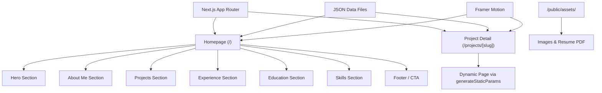
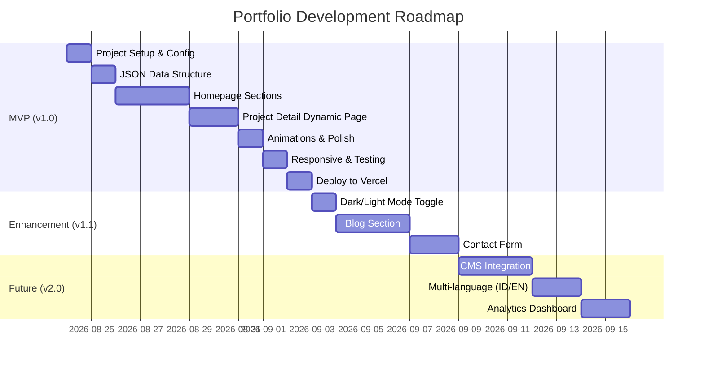

# 📄 Product Requirements Document (PRD)
# Portfolio Pribadi — Personal Branding & Career Platform

| Field          | Value                          |
|----------------|--------------------------------|
| **Author**     | Luna (PM) & Mattz (Stakeholder)|
| **Version**    | 1.0                            |
| **Created**    | 2026-08-23                     |
| **Status**     | Draft — Awaiting Feedback      |
| **Tech Stack** | Next.js · Tailwind CSS 4 · Framer Motion |

---

## 1. Executive Summary

### Problem Statement
Recruiter dan hiring manager butuh cara cepat untuk menilai kapabilitas seorang developer. Portfolio konvensional (PDF/LinkedIn) tidak cukup menampilkan depth of work — hanya menampilkan judul project tanpa konteks masalah, solusi, dan keputusan teknis yang diambil.

### Proposed Solution
Membangun sebuah **personal portfolio website** yang dirancang khusus untuk audiens recruiter, menampilkan tidak hanya daftar project, tapi juga **case study lengkap** per project (masalah, solusi, alasan tech stack) dalam halaman dinamis tersendiri. Website bersifat professional, clean, dengan subtle transitions menggunakan Framer Motion.

### Success Criteria

| KPI | Target | Cara Ukur |
|-----|--------|-----------|
| Lighthouse Performance Score | ≥ 90 | Lighthouse audit |
| Lighthouse Accessibility Score | ≥ 95 | Lighthouse audit |
| First Contentful Paint (FCP) | ≤ 1.5s | Web Vitals |
| Time-to-Interactive (TTI) | ≤ 2.5s | Web Vitals |
| Resume Download Click Rate | Trackable via analytics | Event tracking |
| Recruiter bounce rate | ≤ 40% | Analytics |

---

## 2. User Experience & Functionality

### 2.1 User Personas

#### Persona 1: Recruiter / HR — "Rina"
- **Umur**: 28-40 tahun
- **Goal**: Cepat menilai apakah kandidat cocok untuk posisi yang dibuka
- **Behavior**: Scan cepat (< 30 detik), lihat tech stack, lihat project, lalu download CV
- **Pain Point**: Portfolio yang terlalu panjang, tidak jelas skill-nya, atau tidak ada CV download

#### Persona 2: Hiring Manager / Tech Lead — "Budi"
- **Umur**: 30-45 tahun
- **Goal**: Menilai kedalaman teknis dan problem-solving skill kandidat
- **Behavior**: Klik masuk ke detail project, baca case study, lihat screenshot
- **Pain Point**: Portfolio yang hanya menampilkan nama project tanpa konteks teknis

#### Persona 3: Diri Sendiri — Personal Branding
- **Goal**: Memiliki "digital home" yang merepresentasikan identitas profesional
- **Behavior**: Update berkala saat ada project/pengalaman baru

---

### 2.2 Sitemap & Page Structure

```
/ (Homepage - Single Page)
├── Hero Section
├── About Me Section
├── Projects Section (Grid/List)
├── Experience Section (Timeline)
├── Education Section (Timeline)
├── Skills Section (Grid)
└── CTA / Footer

/projects/[slug] (Dynamic Page - Per Project)
└── Project Detail / Case Study
```

---

### 2.3 User Stories & Acceptance Criteria

#### US-01: Hero Section
> **As a** visitor, **I want to** langsung melihat nama, foto, dan title/role **so that** aku tahu siapa pemilik portfolio ini dalam 3 detik pertama.

**Acceptance Criteria:**
- [ ] Menampilkan foto/avatar profil
- [ ] Menampilkan nama lengkap
- [ ] Menampilkan title/role (misal: "Fullstack Developer")
- [ ] Menampilkan tagline singkat (opsional, 1 kalimat)
- [ ] Terdapat CTA button "Download Resume" yang langsung men-download file PDF
- [ ] Terdapat social links (GitHub, LinkedIn, dll)
- [ ] Subtle entrance animation menggunakan Framer Motion (fade-in / slide-up, durasi ≤ 600ms)

---

#### US-02: About Me Section
> **As a** recruiter, **I want to** membaca ringkasan tentang kandidat **so that** aku bisa menilai culture fit dan motivasinya.

**Acceptance Criteria:**
- [ ] Menampilkan paragraf deskripsi diri (2-4 paragraf)
- [ ] Bisa menampilkan highlight/fun facts (opsional)
- [ ] Section muncul dengan scroll-triggered transition (Framer Motion)

---

#### US-03: Projects Section (Listing)
> **As a** hiring manager, **I want to** melihat daftar project yang pernah dikerjakan **so that** aku bisa memilih project mana yang relevan untuk ditelusuri lebih dalam.

**Acceptance Criteria:**
- [ ] Menampilkan daftar project dalam bentuk card grid
- [ ] Setiap card menampilkan:
  - Nama project
  - Deskripsi singkat (maks 2 baris / ~120 karakter)
  - Tech stack badges
  - Thumbnail/screenshot
- [ ] Klik card → navigasi ke halaman `/projects/[slug]` (bukan modal)
- [ ] Minimal 3 project ditampilkan
- [ ] Card memiliki hover state (subtle scale/shadow transition)

---

#### US-04: Project Detail Page (Dynamic Route)
> **As a** hiring manager, **I want to** membaca case study lengkap sebuah project **so that** aku bisa menilai kemampuan problem-solving dan keputusan teknis kandidat.

**Acceptance Criteria:**
- [ ] Halaman dinamis dengan route `/projects/[slug]`
- [ ] Data di-generate dari JSON menggunakan `generateStaticParams()`
- [ ] Konten halaman menampilkan:
  - **Nama Project**
  - **Deskripsi lengkap project**
  - **Posisi / Jobdesk** — role apa yang dipegang di project ini
  - **Masalah yang Dihadapi** — konteks problem statement
  - **Solusi yang Diterapkan** — pendekatan dan implementasi
  - **Tech Stack** — daftar teknologi yang digunakan, ditampilkan sebagai badges/icons
  - **Alasan Pemilihan Tech Stack** — reasoning di balik keputusan teknis
  - **Screenshot(s)** — gambar hasil project (mendukung multiple images)
- [ ] Terdapat tombol "Back to Projects" atau navigasi kembali
- [ ] Terdapat link ke live demo / repository (jika ada)
- [ ] Page transition smooth menggunakan Framer Motion

---

#### US-05: Experience Section
> **As a** recruiter, **I want to** melihat riwayat kerja kandidat **so that** aku bisa menilai pengalaman profesionalnya.

**Acceptance Criteria:**
- [ ] Menampilkan daftar pengalaman kerja dalam format timeline atau list
- [ ] Setiap item menampilkan:
  - Nama perusahaan
  - Posisi/jabatan
  - Periode kerja (misal: "Jan 2024 — Present")
  - Daftar kontribusi / hal yang sudah dilakukan (bullet points)
- [ ] Diurutkan dari yang terbaru (descending)
- [ ] Scroll-triggered entrance animation

---

#### US-06: Education Section
> **As a** recruiter, **I want to** melihat latar belakang pendidikan kandidat **so that** aku bisa melengkapi assessment terhadap kandidat.

**Acceptance Criteria:**
- [ ] Format mirip Experience Section (timeline/list)
- [ ] Setiap item menampilkan:
  - Nama institusi
  - Jurusan / program studi
  - Periode (misal: "2020 — 2024")
  - Deskripsi singkat / prestasi (opsional)
- [ ] Diurutkan dari yang terbaru (descending)

---

#### US-07: Skills Section
> **As a** recruiter, **I want to** melihat daftar skill teknis kandidat secara visual **so that** aku bisa cepat mencocokkan dengan requirement posisi yang dibuka.

**Acceptance Criteria:**
- [ ] Menampilkan daftar skill dalam bentuk grid badges/chips
- [ ] Skill dikategorikan (misal: "Languages", "Frameworks", "Tools", "Databases")
- [ ] Setiap skill menampilkan nama dan icon/logo (jika tersedia)
- [ ] Tidak menggunakan progress bar / percentage (anti-pattern untuk portfolio)

---

#### US-08: CTA & Footer
> **As a** visitor, **I want to** bisa langsung menghubungi atau download resume **so that** proses lanjutan bisa lebih cepat.

**Acceptance Criteria:**
- [ ] CTA "Download Resume" button — trigger download file PDF
- [ ] File PDF terletak di `/public/` folder
- [ ] Menampilkan social links (GitHub, LinkedIn, Email)
- [ ] Footer menampilkan copyright text

---

### 2.4 Non-Goals (Out of Scope v1.0)

> [!IMPORTANT]
> Fitur-fitur berikut **TIDAK** termasuk dalam scope MVP ini untuk menjaga timeline tetap terkendali.

- ❌ Blog section
- ❌ Contact form (cukup link email / social)
- ❌ Dark/light mode toggle
- ❌ Multi-bahasa (ID/EN)
- ❌ CMS integration (konten hardcoded di JSON)
- ❌ Analytics dashboard
- ❌ Backend / database
- ❌ Authentication

---

## 3. Technical Specifications

### 3.1 Architecture Overview



### 3.2 Tech Stack Detail

| Layer | Technology | Alasan |
|-------|-----------|--------|
| **Framework** | Next.js (App Router) | SSG support, file-based routing, SEO-friendly |
| **Styling** | Tailwind CSS 4 | Utility-first, rapid prototyping, design consistency |
| **Animation** | Framer Motion | Deklaratif, React-native integration, scroll-triggered support |
| **Data** | JSON files (hardcoded) | Simpel, no backend dependency, fast build |
| **Deployment** | Vercel (recommended) | Zero-config untuk Next.js, free tier |
| **Language** | TypeScript | Type safety, better DX, less runtime bugs |

### 3.3 Data Schema (JSON)

#### `data/profile.json`
```json
{
  "name": "string",
  "title": "string",
  "tagline": "string",
  "avatarUrl": "string (path ke /public/)",
  "resumeUrl": "string (path ke /public/)",
  "about": "string (markdown atau plain text)",
  "socials": {
    "github": "string (URL)",
    "linkedin": "string (URL)",
    "email": "string"
  }
}
```

#### `data/projects.json`
```json
[
  {
    "slug": "string (URL-safe, unique)",
    "name": "string",
    "shortDescription": "string (maks 120 char)",
    "fullDescription": "string",
    "position": "string",
    "problems": "string atau string[]",
    "solutions": "string atau string[]",
    "techStack": ["string"],
    "techStackReasons": "string",
    "screenshots": ["string (path ke /public/)"],
    "liveUrl": "string | null",
    "repoUrl": "string | null",
    "thumbnail": "string (path ke /public/)"
  }
]
```

#### `data/experiences.json`
```json
[
  {
    "company": "string",
    "position": "string",
    "startDate": "string (YYYY-MM)",
    "endDate": "string (YYYY-MM) | 'Present'",
    "contributions": ["string"]
  }
]
```

#### `data/education.json`
```json
[
  {
    "institution": "string",
    "degree": "string",
    "field": "string",
    "startDate": "string (YYYY)",
    "endDate": "string (YYYY)",
    "description": "string | null"
  }
]
```

#### `data/skills.json`
```json
[
  {
    "category": "string (misal: 'Languages', 'Frameworks')",
    "items": [
      {
        "name": "string",
        "icon": "string | null (path atau icon name)"
      }
    ]
  }
]
```

### 3.4 Folder Structure

```
porto-v2/
├── app/
│   ├── layout.tsx              # Root layout (font, metadata)
│   ├── page.tsx                # Homepage
│   └── projects/
│       └── [slug]/
│           └── page.tsx        # Project detail page
├── components/
│   ├── sections/
│   │   ├── HeroSection.tsx
│   │   ├── AboutSection.tsx
│   │   ├── ProjectsSection.tsx
│   │   ├── ExperienceSection.tsx
│   │   ├── EducationSection.tsx
│   │   ├── SkillsSection.tsx
│   │   └── Footer.tsx
│   ├── ui/
│   │   ├── Button.tsx
│   │   ├── Badge.tsx
│   │   ├── Card.tsx
│   │   ├── Timeline.tsx
│   │   └── SectionHeading.tsx
│   └── animations/
│       ├── FadeIn.tsx
│       └── ScrollReveal.tsx
├── data/
│   ├── profile.json
│   ├── projects.json
│   ├── experiences.json
│   ├── education.json
│   └── skills.json
├── public/
│   ├── images/
│   │   ├── avatar.jpg
│   │   └── projects/
│   ├── resume.pdf
│   └── icons/
├── lib/
│   └── data.ts                 # Helper functions to load JSON
├── types/
│   └── index.ts                # TypeScript interfaces
├── tailwind.config.ts
├── next.config.ts
└── package.json
```

### 3.5 Key Implementation Notes

> [!TIP]
> **Static Generation**: Gunakan `generateStaticParams()` di `/projects/[slug]/page.tsx` agar semua project detail page di-generate saat build time. Ini memastikan performa optimal dan SEO-friendly.

> [!NOTE]
> **Animation Strategy**: Gunakan Framer Motion hanya untuk:
> - Entrance animation (fade-in, slide-up) pada tiap section saat scroll
> - Page transition antar halaman
> - Hover state pada cards
> - Durasi animasi: **300ms — 600ms** (tidak lebih, agar tetap professional)

### 3.6 SEO & Metadata
- Setiap halaman wajib memiliki `<title>` dan `<meta description>` yang unik
- Gunakan Next.js `metadata` export di setiap page
- Open Graph tags untuk sharing di social media
- `robots.txt` dan `sitemap.xml` di-generate otomatis

### 3.7 Responsive Design
- **Mobile-first** approach
- Breakpoints mengikuti default Tailwind:
  - `sm`: 640px
  - `md`: 768px
  - `lg`: 1024px
  - `xl`: 1280px
- Semua section harus terlihat baik di mobile (recruiter sering buka dari HP)

---

## 4. Security & Privacy

| Concern | Mitigation |
|---------|-----------|
| Tidak ada user input / form | Risiko XSS minimal |
| Data hardcoded (no API) | Tidak ada risiko injection |
| Resume PDF di public folder | Pastikan tidak ada info sensitif berlebihan di CV |
| Dependencies | Rutin audit dengan `npm audit` |

---

## 5. Risks & Roadmap

### 5.1 Phased Rollout



### 5.2 Technical Risks

| Risk | Impact | Likelihood | Mitigation |
|------|--------|-----------|-----------|
| Tailwind CSS 4 breaking changes | Medium | Low | Pin versi, cek compatibility sebelum upgrade |
| Framer Motion bundle size terlalu besar | Medium | Medium | Gunakan dynamic import, hanya import komponen yang dipakai |
| Screenshot/image terlalu berat | High | High | Gunakan Next.js `<Image>` component dengan auto-optimization |
| JSON data jadi terlalu besar | Low | Low | Untuk MVP, JSON kecil. Migrasi ke CMS di v2.0 jika perlu |

---

## 6. Testing Strategy

### Manual Testing Checklist
- [ ] Semua section render dengan benar di desktop (1280px+)
- [ ] Semua section render dengan benar di mobile (375px)
- [ ] Semua section render dengan benar di tablet (768px)
- [ ] CTA "Download Resume" berhasil men-download file PDF
- [ ] Navigasi ke semua project detail page berfungsi
- [ ] Tombol "Back" dari project detail berfungsi
- [ ] Semua link external (GitHub, LinkedIn) buka di tab baru
- [ ] Animasi berjalan smooth (no jank, 60fps)
- [ ] Lighthouse Score: Performance ≥ 90, Accessibility ≥ 95
- [ ] SEO meta tags ter-render dengan benar (cek via View Source)

---

## 7. Definition of Done (DoD)

Fitur dianggap **selesai** jika memenuhi semua kriteria berikut:

- [ ] Semua acceptance criteria di setiap User Story terpenuhi
- [ ] Responsive di 3 breakpoint utama (mobile, tablet, desktop)
- [ ] Lighthouse Performance ≥ 90
- [ ] Lighthouse Accessibility ≥ 95
- [ ] Tidak ada error di console browser
- [ ] Deploy sukses di Vercel (atau platform sejenis)
- [ ] Screenshot evidence untuk setiap section

---

> [!NOTE]
> **Dokumen ini adalah living document.** Update akan dilakukan seiring perkembangan project. Versi terbaru selalu menjadi source of truth.
